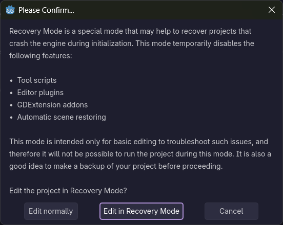
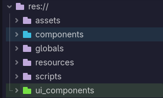

<blockquote class="reddit-embed-bq" style="height:500px" data-embed-height="467">
<a href="https://www.reddit.com/r/godot/comments/1xhyvhb/im_in_godot_ui_hell/">I'm in Godot UI hell</a>  by
<a href="https://www.reddit.com/user/Muckwick/">u/Muckwick</a> in
<a href="https://www.reddit.com/r/godot/">godot</a>
</blockquote>

(I did tell you last week. It's a whole bit on the subreddit right now.)

---

## Tasks Worked On

[Commits this week](https://github.com/KxtR-27/CS414_VipWaveSurvival/commits/main/?author=KxtR-27&since=2026-10-26&until=2026-11-02)

- Separate `components` from `ui_components`
- VIP panic mechanic
- WIP spooky level
- Debug level features
- Windows `x86_64` build preset
- Started on dialogue boxes

## Time Estimation

My work this week took about five hours.
This was longer than expected because of the struggles I ran into.

## Struggles? Oh man...

The panic mechanic was very buggy and still is.
Part of this is because it was a rushed addition to fit within Milestone 2.
Part of this is because our current code for the characters is piling up bad.

We had a lot of critical errors.
Some of which I created, haha.
But the biggest struggle to learn from was...

### Godot Editor and You: Recovery Mode

Tool scripts are fun!
However, tool scripts are also unstable, and they infamously despise onready variables.
Since tool scripts treat the editor as a runtime,
the editor becomes subject to the risks and pitfalls of trying to access an object that hasn't yet loaded.

Sometimes, this issue is so catastrophic that loading a scene will crash your whole editor.
When you reopen the editor, it tries to load that scene again and crashes immediately.
So what do you do?
While you could open an external editor and try to find the problematic node or line of code,
there is a better option:

**Recovery mode!**

Recovery mode disables many editor features to safely load any problematic scene or script or resource.
Most importantly for us, this includes disabling all tool scripts.
Now, instead of trying to troubleshoot a scene from a text editor (nightmare),
we can use the Godot Editor to look at it instead.
Here's how:

1. Open your Godot executable so that the project list appears.
2. Click on your project **once** to select it.
3. On the right sidebar, _next_ to the <kbd>✏ Edit</kbd> button, press the <kbd>˅</kbd> arrow.
4. In the dropdown, select <kbd>⚠️ Edit in recovery mode</kbd>
5. At the bottom of the popup, select <kbd>Edit in Recovery Mode</kbd>.
6. Voila!

## Team Communication

Things are good!
I've been pleased with our communication.
While this mainly concerns communication outside of class,
I want to add that our communication in class is very good as well.
I really respect and appreciate the open-minded and respectful attitudes that my teammates speak with.
We've reached a point where we're not afraid to criticize each others' work
while understanding that each others' criticism comes from a good place.
When I share my ideas, I feel satisfied that they are genuinely considered,
and I am not upset when the team chooses another idea over an idea that I posed.

### A Gold Star Story ⭐

Though this short story took place prior to this week, Gold Stars were only introduced today.
Gold Stars show recognition for students doing cool things.

A week or two ago, I was helping Matilde with a bug in Creepy Crawlers.
When hovering the mouse over the inventory, the inventory would stay open.
However, when hovering the mouse over an item _inside_ the inventory,
the game would deduce that the mouse was no longer hovering over the inventory and close it
when this was not the case.

During this session, I noticed that his folders in the Godot file explorer were all kinds of colors.
I asked him how to do it, and it was shockingly easy.

The reason this deserves a gold star is that it actively helped me when separating `components` from `ui_components`.
The separation was necessary because the number of subfolders in our `components` folder was growing so large
that it became very difficult to find what we were looking for.
The separation did remedy this, but the folder names were similar and not adjacent,
so, though some readability was gained, some was lost, too.

But, making the `components` folder blue (like a `Node2D`) and the `ui_components` folder green (like a `Control`)
made the folders easy to spot and easy to differentiate.
It really is the little things.

That deserves a gold star!

<i>P.S.: the fix for Matilde's issue was to set the `mouse_mode` for all inventory items to `IGNORE`.</i>

---

Cheers.
