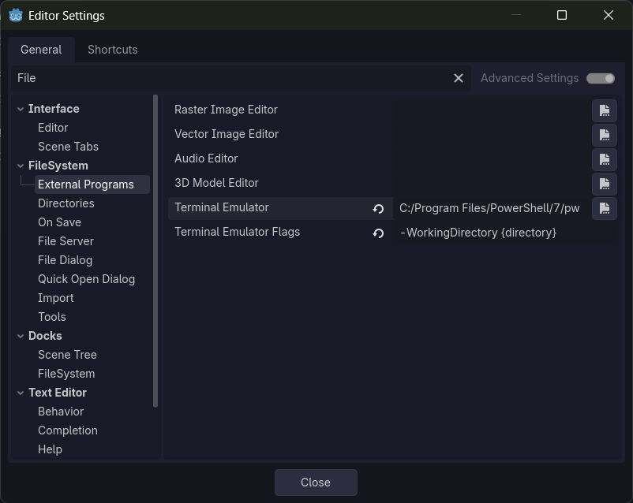

<blockquote class="reddit-embed-bq" style="height:500px" data-embed-height="539">
<a href="https://www.reddit.com/r/godot/comments/1xqokz7/guys_i_understand_the_control_system_now_maybe/">Guys I understand the Control system now... (maybe)</a>  by
<a href="https://www.reddit.com/user/poeyoh12/">u/poeyoh12</a> in
<a href="https://www.reddit.com/r/godot/">godot</a>
</blockquote>

(On the topic of our running Godot UI schtick. This is pretty cool.)

## Tasks Worked On

<!-- untab/unbreak when you have an actual link -->
<!-- prettier-ignore -->
[Commits this week](https://github.com/KxtR-27/CS414_VipWaveSurvival/commits/main/?author=KxtR-27&since=2026-11-02&until=2026-11-09)

- Skill tree!
    - Generator
    - Skill resources
    - Live updates when skill resources change
    - Can save to resource files
- Playtesting [notes](https://github.com/KxtR-27/CS414_VipWaveSurvival/blob/main/docs/playtests/milestone_2/pizza_for_playtests_2.md)

My team will be analyzing the playtesting notes this week,
so expect takeaways in the _next_ journal.

## Time Estimation

This work took about four and a half hours, which was longer than I anticipated.
The skill tree was giving me a lot of trouble from the `@tool`ing side of things.
It took a long time to finally decide on data-driving the skill components and getting them to update live.

## Struggles?

### Skill Tree

Yes, the skill tree.

- Arrays and dictionaries actually make shallow copies.
  So, if your resources are instantiated within a scene and held inside of an array or dictionary,
  they become completely local. This meant that, when mapping a skill tree's skills to skill components,
  the components would actually make disconnected copies of the skills. ugh.
- A bunch of export variables that relied on `@onready` or `_ready()` mechanics would crash.
  Even in the editor. Because it's a tool script.
- Originally, the skill tree had to manually configure every skill component itself.
  It wasn't until about two hours in that I made the skill components manage themselves based on a given skill.
- `func.call_deferred()` fixed many loading errors, but not all.
- Every time anyone other than myself tries to change the skill tree in some way,
  it throws a bunch of errors for them. Yay.

### `Open in Terminal`

Godot gives you the ability to open a folder in your terminal straight from the editor.
By default, this is whatever your operating system says is _the terminal_.
For Windows 10 users, this is often Command Prompt.
For Windows 11 users, this is often PowerShell 5.1.

But PowerShell 5.1 is outdated, and it doesn't support a lot of modern commands on which I rely.

So how do you tell Godot to use PowerShell 7 instead?

1. Open **Editor Settings**. \
   If you have project open, go to the <kbd>Editor</kbd> tab and press <kbd>🛠️ Editor Settings</kbd>. \
   _**OR**_ \
   From your projects list, go to <kbd>🛠️ Settings</kbd> and click <kbd>Edit All Settings</kbd> in the bottom right.

2. Either by searching or by scrolling through, go to **FileSystem > External Programs**.

3. Set the value for <kbd>Terminal Emulator</kbd> to
   `C:/Program Files/PowerShell/7/pwsh.exe` or wherever your PowerShell 7 is.

4. To prevent PowerShell 7 from immediately closing due to bad arguments,
   set the value for <kbd>Terminal Emulator Flags</kbd> to `-WorkingDirectory {directory}`. \
   This tells PowerShell to open regularly in the folder you selected from the Godot Editor.

5. Voila! Right-clicking a folder and pressing Open in Terminal will now use PowerShell 7!
   You've now saved the hour that it took me to figure this out.

## Team Communication

While it has been a bit frustrating to see another team member break my skill tree by modifying it without asking for my help first,
team communication and rectifying these issues has gone well, so I cannot be mad.
The big communication has yet to come, though, when we analyze playtest results and decide our next steps.

## Gold Stars

**_Matilde_** informed me that you can press <kbd>F1</kbd> in the Godot Editor to browse documentation both for internal classes and classes you've made.
Before this I had to use a roundabout way to view documentation for my own scripts
in which I make a link in the doc comment and click it to access the script's documentation view.
I write a lot of documentation, so this is very nice.

---

Cheers. ✨
