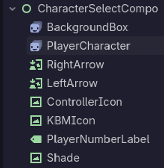
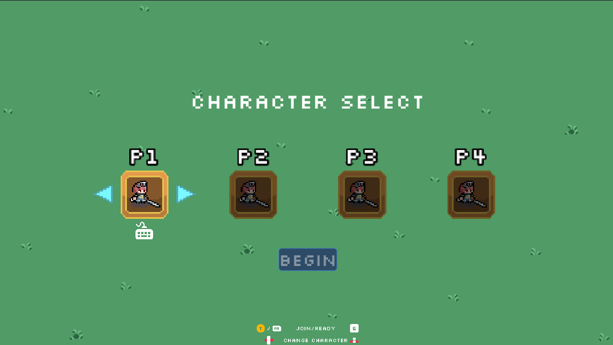
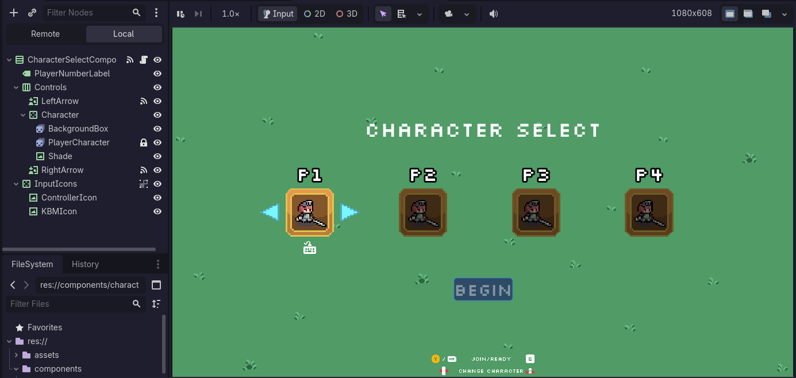

## Tasks Worked On

[This week](https://github.com/KxtR-27/CS414_VipWaveSurvival/commits/main/?author=KxtR-27&since=2026-10-19&until=2026-10-26)
focused on some general housekeeping and some very specific UI restructuring.
I hope you like hearing about responsive (web) design.

- Control hints are finally a thing
- A bunch of type-safety-related debugger warnings
- **✨ Character Select Responsive Design ✨** (a doozy)

Fair warning: there's a lot, and it's a bit rushed, because there's a lot.

## Time Estimation

Five hours? I did not keep track, but this stuff had me up for a WHILE.
I definitely spent at least five hours on things this week,
at least three of which was on the Character Select menu and nothing else.

## Scaling Struggles: Godot UI & You

There exist many simple truths about Godot.
Among them is this week's star of the show:

_**Nobody understands Control nodes.**_

_**Nobody. I keep seeing this on Reddit, too.**_

_**In fact, after I wrapped it all up into a PR,
both my teammates admitted that Control nodes are beyond them.**_

I, however, am cursed with the knowledge of frontend web development and design.
A lot of it.
That's what happens when you're a dev at the Digital Corps.
Especially if you write your own CSS for everything, which I do.
Anyway. I'm getting off track.

If you want to skip to the real good stuff, click
[here](http://localhost:8080/blog/journal-9/#the-outcomes-because-holy-moly-i-am-not-going-to-read-remember-your-choice-all-that).
You're welcome for sparing you.

### The Problem: Scaling

Scalable vector graphics.
Rather than mapping to pixels like a JPEG or a PNG,
they adapt to the current size by redrawing a specialized set of shapes at any resolution.
You can most easily see this effect when rapidly zooming in on an emoji in your browser, such as one of these:
🐬✨⚪⭐💔⛓️‍💥🔗⚡⚠️🕊️✏️😔🏈🏀📩📄↪️♥️😭🚫❎✅🎉❤️

You might notice that, for just a moment, as you zoom in they become very blurry.
The next moment, they're razor sharp again.
**Godot does this for its Control nodes**,
such as buttons, labels, panels, and other graphical UI nodes.

However, coming from the world of 2D nodes,
its easy to make the mistake of editing the Scale Transform of a Control node to make it bigger or smaller.
This has the intended effect,
but scaling things up makes them weirdly blurry or full of mixels for no immediately apparent reason.
Likewise, scaling Control nodes down tends to make the edges weirdly sharp,
and they behave strangely if they move smoothly across the screen.
Why does this happen?
**<ins>When you scale a Control node, it still redraws itself for the unscaled resolution.<ins>**

Well, then, what do you do?

### Here's what you do.

First. Reset basically all transform changes, including translation and scale.

To conserve space in this already sprawling post, here's an excerpt from my corresponding
[PR](https://github.com/KxtR-27/CS414_VipWaveSurvival/pull/74),
which you should definitely read fully if this conundrum interests you.

> #### Pointers
>
> - `TextureRect`s should change their **Expand Mode** and **Stretch Mode** instead of having their transform scaled. If you want them to be bigger than the texture's pixel size, modify the **Custom Minimum Size** such that it expands and/or stretches to fit.
>     
> - `Container` descendants can likewise be given a **Custom Minimum Size**, and certain element stretch modes will scale to fill this space.
>     
> - For other UI elements, instead of editing scale, edit their **Layout > Container Sizing** instead. Generally, `Fill` will stretch them to fit, but `Shrink Begin`, `Shrink Center`, and `Shrink End` will instead preserve the aspect ratio of the UI element.
>     
> - The `CenterContainer` stacks its children on top of each other, which is useful for stacking both sprites and the Shade.
>     
> - Customizing a Label should almost always use a new `LabelSettings` resource in its **Label Setting**, NOT its `Control`-based **Theme Overrides**.

Also if you have things that look like they should go in a row, use an `HBoxContainer`.
How about a column? There's a `VBoxContainer` for that, too.

The nesting of components can seem confusing if not dizzying at first, but with enough tweaks to these things, you can get a nearly identical result!

### The Outcomes because holy moly I am NOT going to (read/remember, your choice) all that.

- Stop using the Layout > Transform scale and start scaling things responsively.
- Stop positioning absolutely and start using anchors.
- Set custom minimum and maximum sizes when you need things to be of a specific size.
- Follow this flowchart!

<iframe src="https://mermaid.live/embed?theme=redux-dark-color&look=classic&mode=dark&controls=0&grid=0#pako:eNqNU8lu2zAQ_ZUJL1GA2L370CLxngZo0Q1Iqx7G1NgiLHGEIWVbifPvHSm1E3cBIkCE3uzvcfRgLGdkBmZZ8NbmKBG-jFJJPehzBb3eW7juzuHBOGzhfg5b9BEiA4qgXxHEnErYkERnsSia_n4Er0rJWdw9-_iUNP5fToho108ZrF3UVAEvgdDmwGqW_n7yqn7OQ-CS9FCuWkHIRvXWBQosMeSOfX8__aPUeQkF89r5FSxZugIxbxFC4WIstFzlrGunmLWph_RRp938AMencHIKp6dw9gwPpvnThZzCm5cRVz_mkOOGWtosK_TunnTIlXDd6eX1tsPZz0P4dfJZ6SvlgzaaZrms2JOP4U2w5CnAAgNloEHbHCOUuFabxkPJIUKgUmV2Vj98oP7FUbmHGW8hY53yhf6BYONC3V72u8ejSsm3a94N2yVwnuRYYpzM_mmfJEMdj-RvzzSZisuOdti6mCuhoi59OAbNkg9rbFSKrXJpFgQN12DR6yu0rHU05RJhB-gzaKDi4FqJQh-GV5_Gk6-3t3fPNOfJe6IKFkLYrYeLynnrz2AezwMoT8AF1xFoV5G4UufGtthzgZvkDpumaYc4F9JkT32Y6JLpfH34KLzAhf4ZF-bSrJSbGSyxCHRpSpISW2weUtPeHqVmkBqhrN71MpR1T3mzpOYyNe3udl5bYAjOdsZAthYXm1vaUNF5QxRnY2oetVeF_jtzaQZRau2m-7PKj73rKsNII4crwd8hj78AKIlo8w" width="100%" height="480" style="border:0" loading="lazy" title="Mermaid diagram" sandbox="allow-scripts allow-same-origin allow-popups allow-popups-to-escape-sandbox"></iframe>

Y'know in hindsight, I'm not so sure that explains it very well...
Anyway! Pictures!

#### Before

#### After

<i>
    It's basically the same! But with no more scaling issues! 
    Also, when we add things in the future, 
    things aren't liable to break as they did when I started this whole ordeal!
</i>

And with that, just a few changes have a big effect.

## Team Communication

Team communication was a big issue here, as you may see in the PR.

Way back in Journal 5, I covered the last time I dared make an unsolicited PR.
It did not go over well. 
I overwrote Alex's hard work without a second thought, which was totally my bad.
It worked out well in the end, but it wasn't fun.

This time, however, there's one big difference: **Alex's work is practically untouched.**
I went to great lengths to ensure that this was the case.
Alex spent a lot of time designing this screen as well as the impressive amount of state management behind it.
This time around, that was my number one priority.
I was only here to fix scaling, after all.

Many times throughout development, 
when state management was touch-and-go,
I cannot deny that there was an urge to rewrite it all myself.
But I decided to trust the process. 
Over the past few weeks, Alex addressed so much surrounding this menu mechanically,
and it has come together incredibly cleanly.

In the end, the solution favored everyone.
It's _these things_ that motivate me to make games.
Not the game itself, but the compassion around it, 
and the people's works to which I can dedicate my own.

Cheers. Queue the fanfare.

<audio src="/06 - Victory!.mp3" controls></audio>
 
<i><a href="https://xdeviruchi.bandcamp.com/track/victory" target="_blank">xDeviruchi - Victory!</a> as seen in VIP Wave Survival</i>
